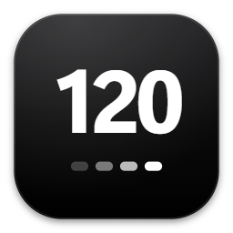
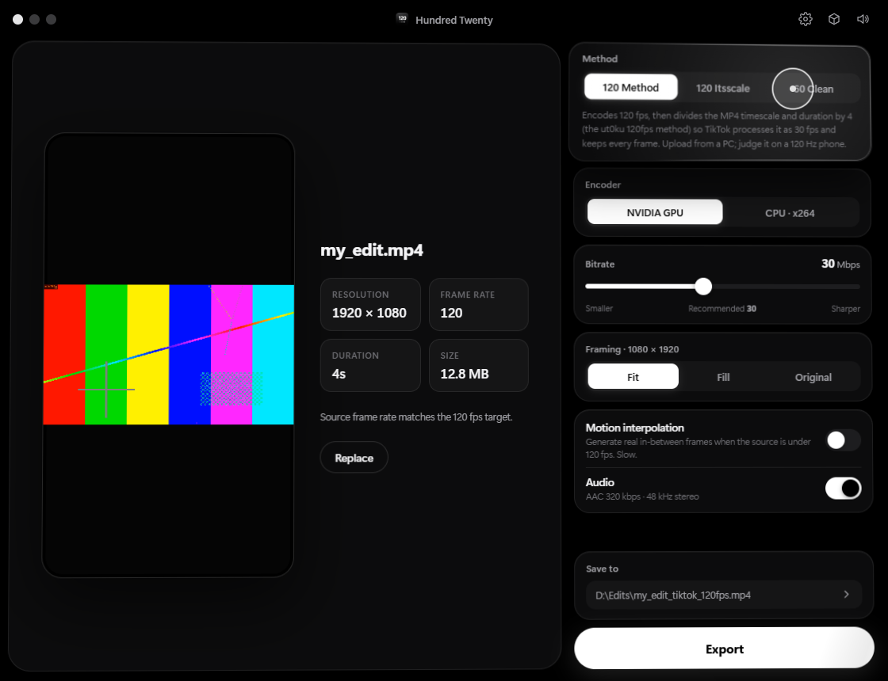
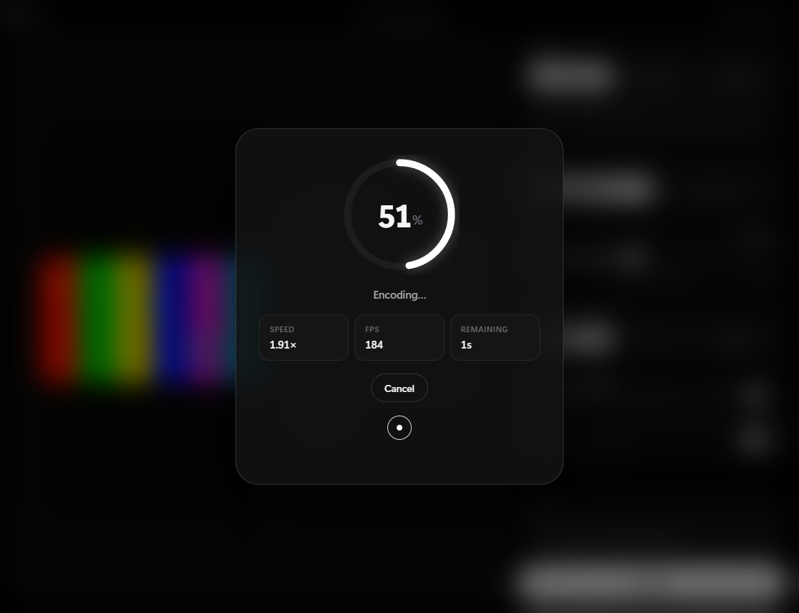
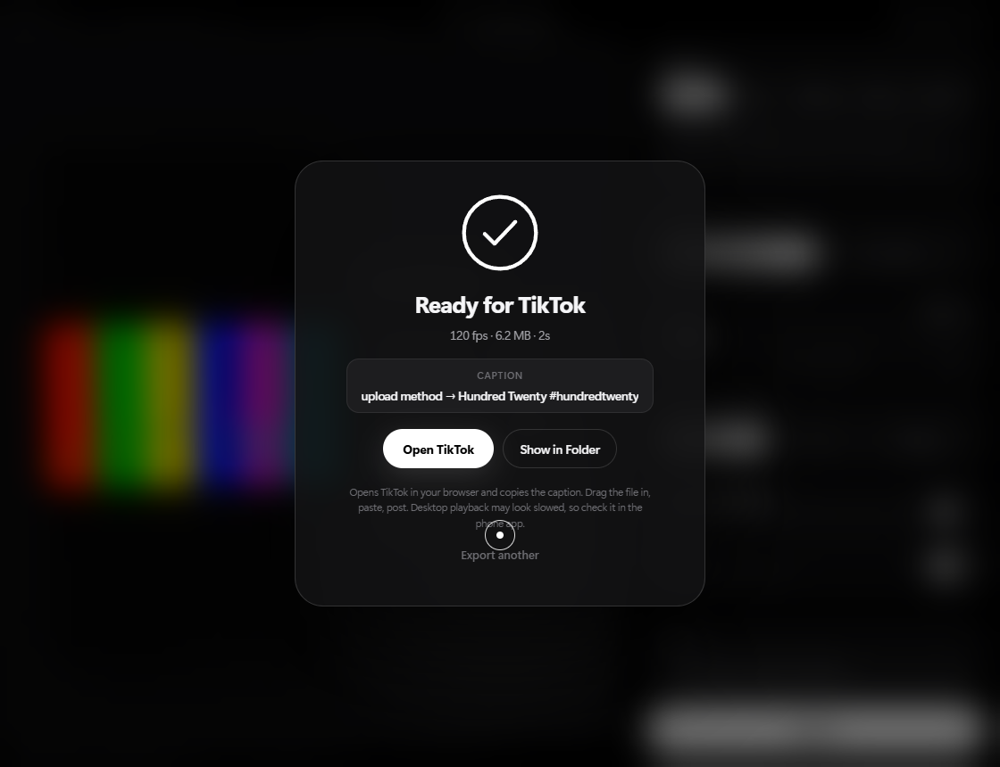
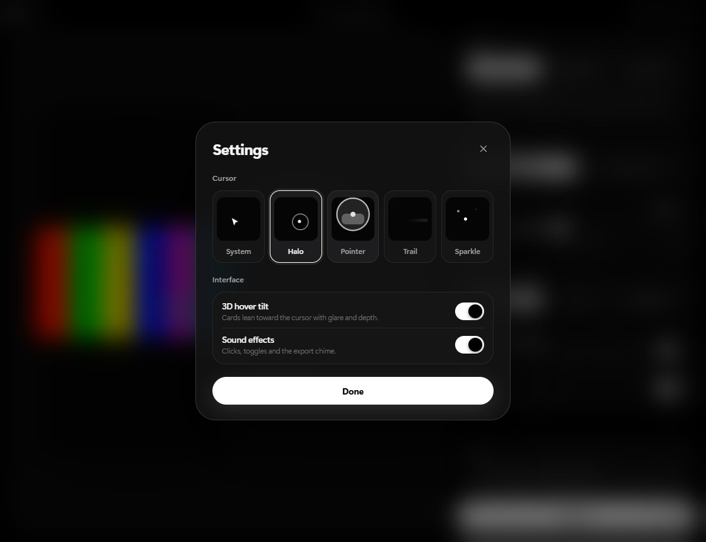
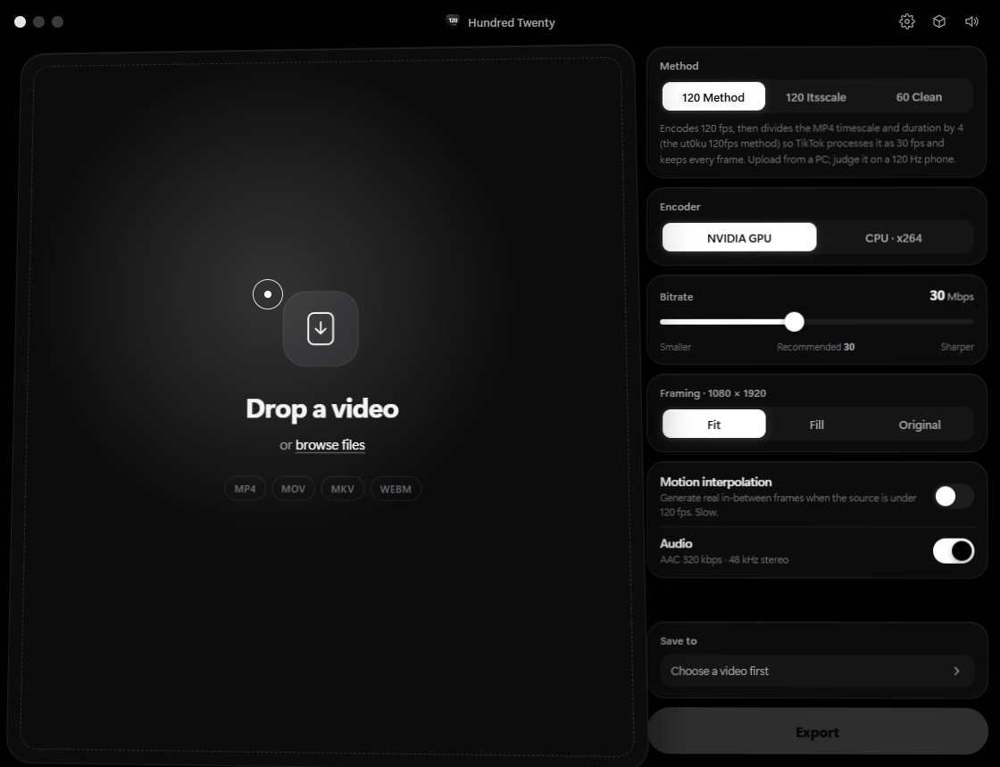

  

<h1 align="center">Hundred Twenty</h1>

<b>120fps exports for TikTok, in one click.</b>

  <a href="../../releases/latest"><b>Download for Windows</b></a>

  

Hundred Twenty takes any edit, encodes it at a true 120fps with FFmpeg and preps it for TikTok's 120fps upload method. You don't touch the command line, patch anything by hand or guess settings.

## Features

- **Drop and export.** Drag in an MP4, MOV, MKV or WEBM, then hit Export.
- **120 Studio.** Encodes true 120fps and writes the file so TikTok serves your original upload untouched. Tested on a public post: 120fps, every frame.
- **Experimental methods.** Pass (CompressBase-style), Method (based on [ut0ku/120fps-method](https://github.com/ut0ku/120fps-method)) and Itsscale.
- **60 Clean.** Plain 1080p60 for when you just want it to look right everywhere.
- **GPU encoding.** NVIDIA NVENC at its highest-quality preset, with a CPU (x264) fallback.
- **Tuned settings.** 120 Studio uses 1080×1920, H.264 Constrained Baseline L5.1, ~12 Mbps, AAC. A bitrate slider is there if you want more.
- **4K export (Risky).** Opt-in for Studio: a source bigger than 1080p keeps up to 2160p at 45 Mbps. It passed its first TikTok test, but it's new, so it's off by default.
- **Output summary.** See the frame size, bitrate, encoder and an estimated file size before you export.
- **Motion interpolation.** Builds real in-between frames for clips under 120fps.
- **One-click TikTok.** Opens TikTok Studio in your browser with the caption already copied.
- **Automatic updates.** New versions download in the background and install on restart. No more redownloading.

## Design

Make it yours. Pick a layout: **Classic**, **Steps** (one step at a time), **Pro** (sidebar, inspector and status bar) or **Bento** (every control its own tile). Pick a style: **Clean**, **Glass**, **Terminal** or **Neon**. Then a theme (Midnight, Graphite, Aurora or Light) and one of nine accent colours. Every card tilts in 3D toward your cursor with glare and depth. Spring animations, a live 9:16 preview, a progress ring, sound on every click, and five cursor themes.

  
  

  
  

## Install

1. Go to [Releases](../../releases/latest).
2. Download **HundredTwenty-Setup-1.2.0.exe** (installer) or **HundredTwenty-1.2.0-portable.exe** (no install).
3. Windows may show "Windows protected your PC" because the app isn't code-signed. Click **More info → Run anyway**.

**Already installed?** 1.1.0 updates itself to 1.2.0: restart when the title bar says **Update ready**. On 1.0.0, run the 1.2.0 installer once. It closes the app, removes 1.0.0 and keeps your settings. See the [changelog](CHANGELOG.md).

## How to post at 120fps

1. Export a **120fps** edit from your editor (After Effects, Premiere, CapCut…).
2. Drop it into Hundred Twenty, keep **120 Studio**, hit **Export**.
3. Click **Open TikTok**. Drag the file in, press **Ctrl+V** for the caption, then **Post**.
4. Watch it on a 120 Hz phone. TikTok serves the original file, so give it a few minutes after posting while TikTok checks it.

## Requirements

- Windows 10 or 11 (64-bit)
- NVIDIA GPU recommended (any CPU works with x264)

## Privacy

Hundred Twenty sends anonymous usage stats: a random install ID, the app version, your Windows version, the export mode you used and your country (worked out by the server; your IP address is never stored). It never sends files, file names or account details. Turn it off in Settings → Privacy.

## Notes

Hundred Twenty uses an unofficial upload method. TikTok can change how it processes videos at any time. Use it at your own risk.

## License

Hundred Twenty is closed source. © 2026 messor1053. All rights reserved. See [LICENSE](LICENSE).
