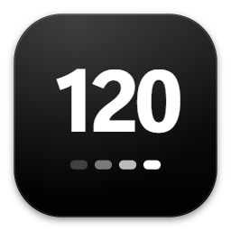
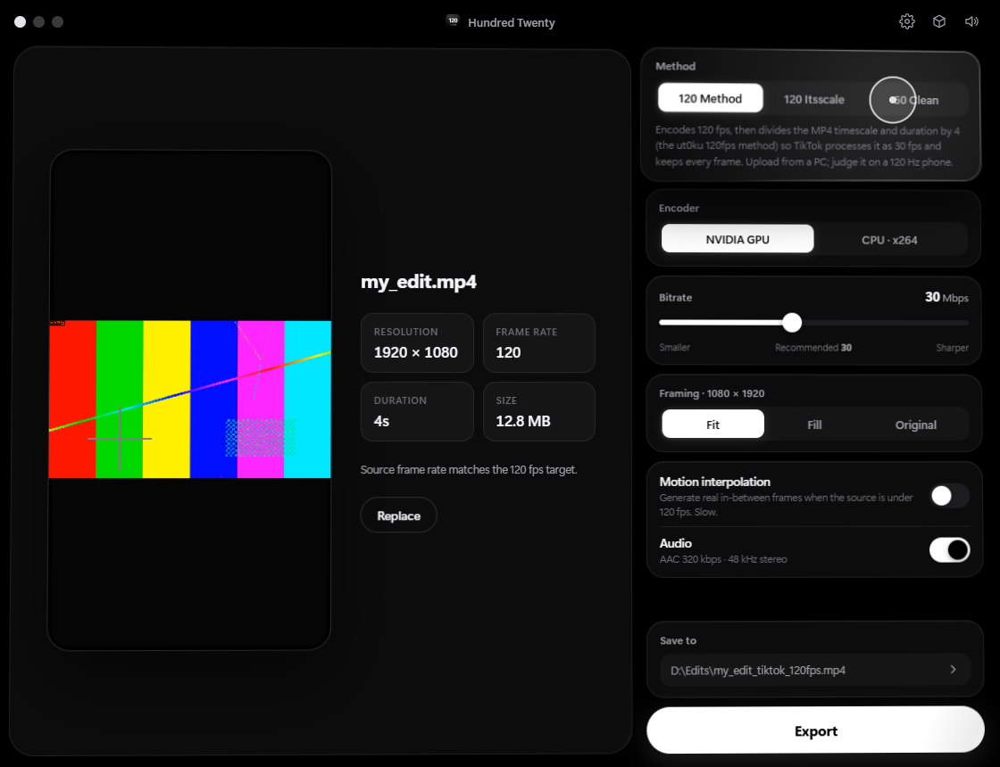
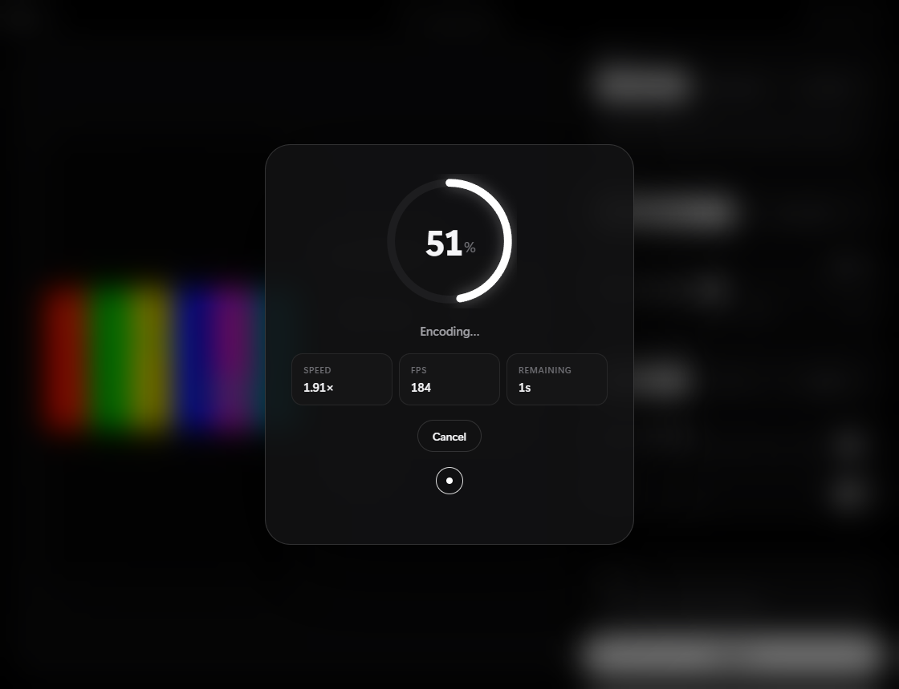
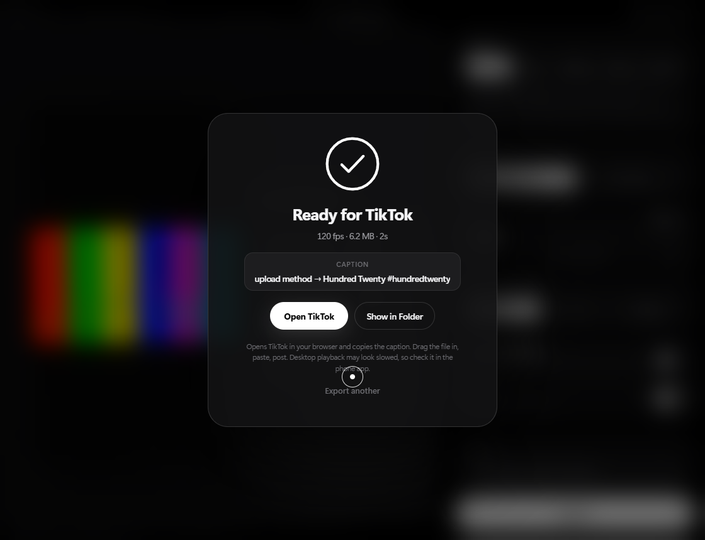
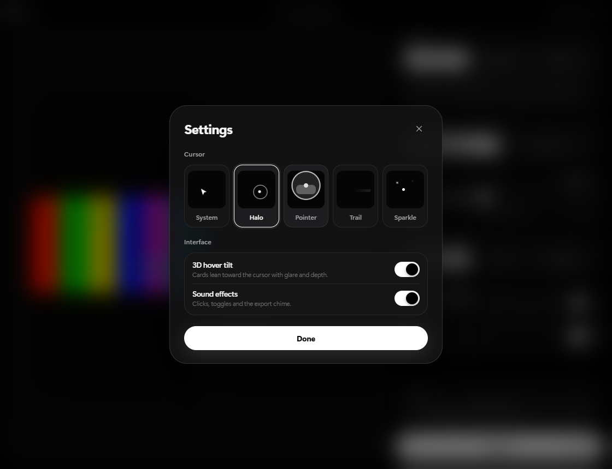
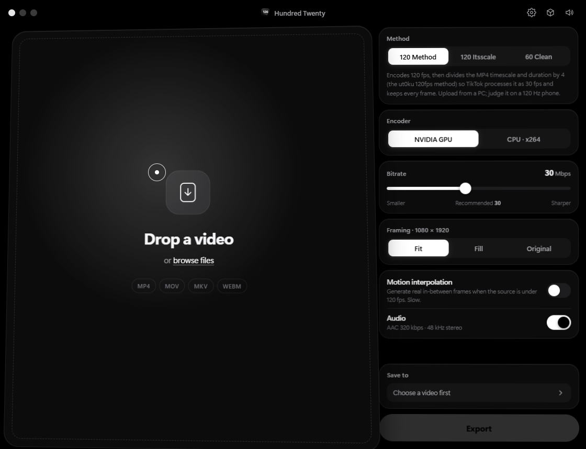

  

<h1 align="center">Hundred Twenty</h1>

<b>120fps exports for TikTok, in one click.</b>

  <a href="../../releases/latest"><b>Download for Windows</b></a>

  

Hundred Twenty takes any edit, encodes it with FFmpeg and preps it for TikTok. You don't touch the command line, patch anything by hand or guess settings.

## Features

- **Drop and export.** Drag in an MP4, MOV, MKV or WEBM, then hit Export.
- **Studio (the default).** True 120fps at 1080p. Studio encodes your edit at 120fps and writes the file with a container patch, so TikTok keeps it exactly as uploaded instead of re-encoding it. Tested on a public post on November 12: the original 1080p file at 120fps, right after posting.
- **Halftime.** A 60 fps option that still uses all of your 120fps frames: each pair is blended into one 60 fps frame at 1080p, at your edit's own speed, so motion looks smoother than dropping half of them. Pick a version: **R12** (the default), **R11** or **R9** (constant quality).
- **Clearframe.** Halftime's smooth 1080p 60 saved as 10-bit HEVC, using your NVIDIA GPU when you have one: the smallest upload for the same result on TikTok.
- **FFMPEG section.** The classic `-itsscale 2` method: pick **60 fps** or **120 fps** to match your video, and your frames are copied untouched with every timestamp doubled, so the file is twice as long and every frame is exactly evenly spaced. It shows the exact ffmpeg command.
- **60 fps.** Normal speed at 1080p 60 fps. A 120fps edit keeps every 2nd frame, so motion stays even.
- **Tuned settings.** 1080×1920 H.264 at about 12 Mbps with AAC audio. A bitrate slider is there if you want more.
- **1080p.** Studio is tested at 1080p. 2K and 4K exports are still there for sources bigger than 1080p, but not tested with the new Studio yet.
- **TikTok optimiser.** Off by default. Makes Halftime R12 and 60 fps files smaller with every frame and the same fps, checked frame by frame against your edit. If it can't shrink without a visible difference, you get the normal export.
- **Output summary.** See the frame size, bitrate, encoder and an estimated file size before you export.
- **Motion interpolation.** Builds real in-between frames for clips under 120fps.
- **One-click TikTok.** Opens TikTok Studio in your browser with the caption already copied.
- **Keyboard shortcuts.** **Ctrl+O** to open, **Ctrl+E** to export, **Ctrl+,** for settings.
- **Automatic updates.** New versions download in the background and install on restart. No more redownloading.

## Design

Make it yours. Pick a layout: **Classic**, **Steps** (one step at a time), **Pro** (sidebar, inspector and status bar) or **Bento** (every control its own tile). Pick one of 14 styles: **Clean**, **Glass**, **Terminal**, **Neon**, **Luxe** (black and gold), **Prism** (iridescent borders), **Chrome** (brushed metal), **Soft** (raised and pressed), **Clay** (puffy and rounded), **Paper** (warm stock and serif type), **Blueprint** (drafting grid), **HUD** (sci-fi brackets), **Brutal** (thick ink and hard shadows) or **Swiss** (grotesk type and rules), or hit **Surprise me**. Then a theme (Midnight, Graphite, Aurora or Light) and one of nine accent colours. Every card tilts in 3D toward your cursor with glare and depth. Spring animations, a live 9:16 preview, a progress ring, sound on every click, and five cursor themes.

  
  

  
  

## Install

1. Go to [Releases](../../releases/latest).
2. Download **HundredTwenty-Setup-1.5.0.exe** (installer) or **HundredTwenty-1.5.0-portable.exe** (no install).
3. Windows may show "Windows protected your PC" because the app isn't code-signed. Click **More info → Run anyway**.

**Already installed?** 1.1.0 and later update themselves to 1.5.0: restart when the title bar says **Update ready**. On 1.0.0, run the 1.5.0 installer once. It closes the app, removes 1.0.0 and keeps your settings. See the [changelog](CHANGELOG.md).

## How to post at 120fps

1. Export a **120fps** edit from your editor (After Effects, Premiere, CapCut…).
2. Drop it into Hundred Twenty, keep **Studio**, hit **Export**. Don't re-export the file.
3. Click **Open TikTok**. Drag the file in, press **Ctrl+V** for the caption, then **Post**.
4. Your post plays at 120fps right away. Check it in the TikTok app on a 120 Hz phone.

## Requirements

- Windows 10 or 11 (64-bit)
- Any 64-bit CPU (exports use x264)

## Built with

- **JavaScript** on **Electron** and **Node.js** runs the app, and a **Cloudflare Worker** handles the signed updates and anonymous stats.
- **HTML** and **CSS** draw the interface: every layout, style and theme.
- **FFmpeg** (x264 + AAC) does the encoding.
- **SQL** defines the stats tables in Cloudflare D1. Other is the Windows installer script (NSIS), a batch launcher and a VBScript starter.

The source code is private, so GitHub's language bar stays empty here. These shares are measured from it.

## Privacy

Hundred Twenty sends anonymous usage stats: a random install ID, the app version, your Windows version, the export mode you used, your country (worked out by the server; your IP address is never stored) and your device's time zone (only compared with where the connection comes from, never stored). It never sends files, file names or account details. Turn it off in Settings → Privacy.

## Notes

Hundred Twenty uses an unofficial upload method. TikTok can change how it processes videos at any time. Use it at your own risk.

## License

Hundred Twenty is closed source. © 2026 messor1053. All rights reserved. See [LICENSE](LICENSE).
